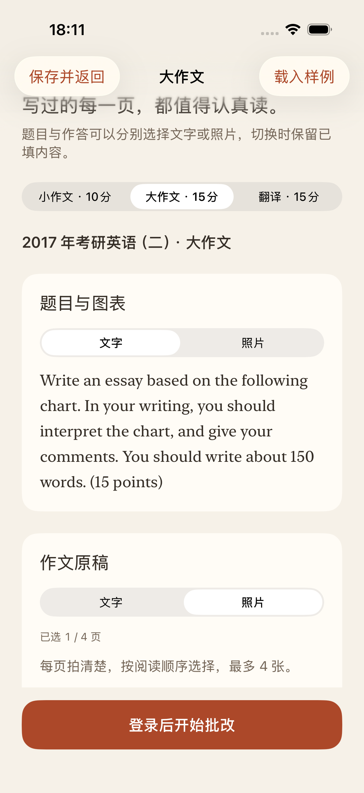
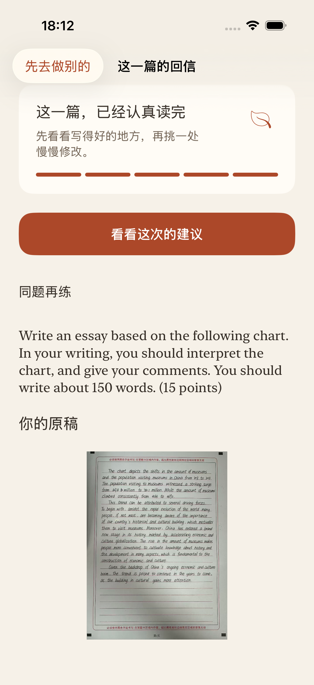
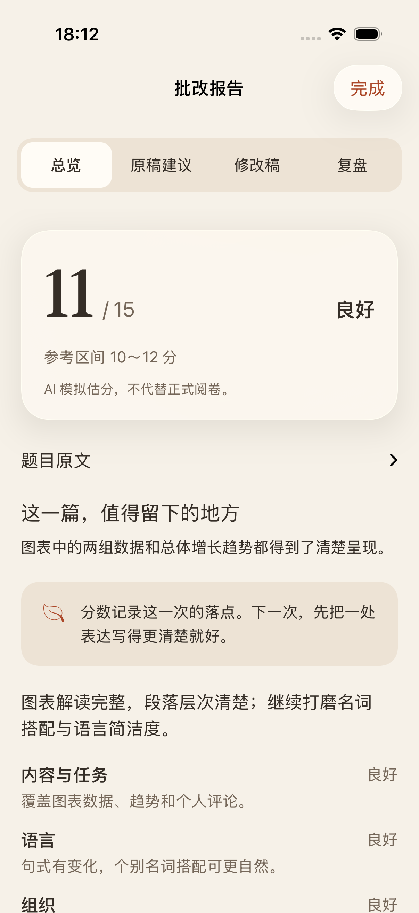
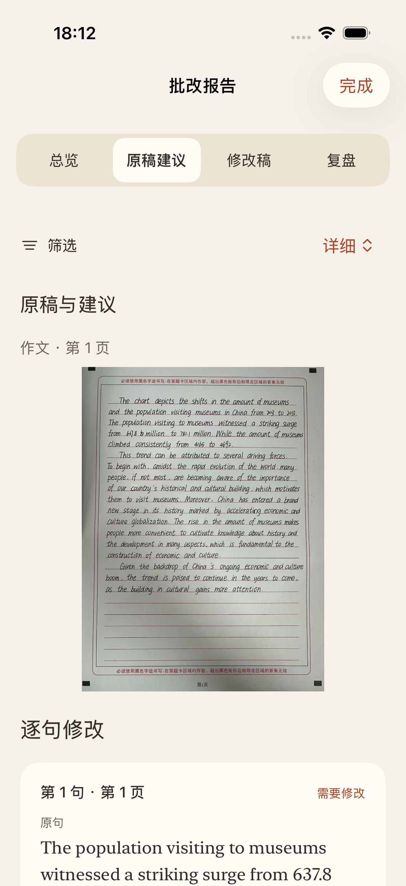
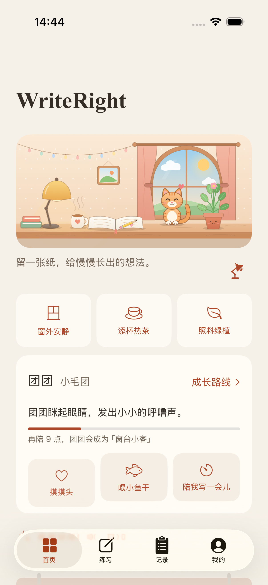
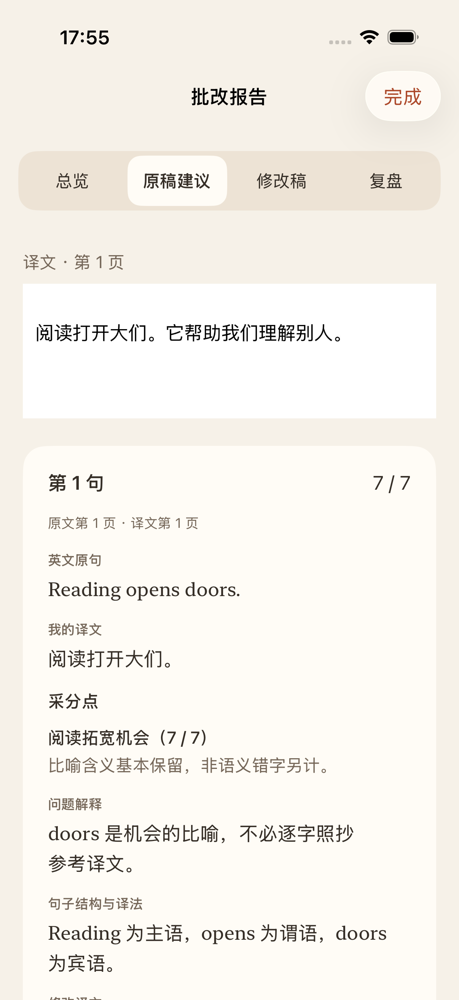
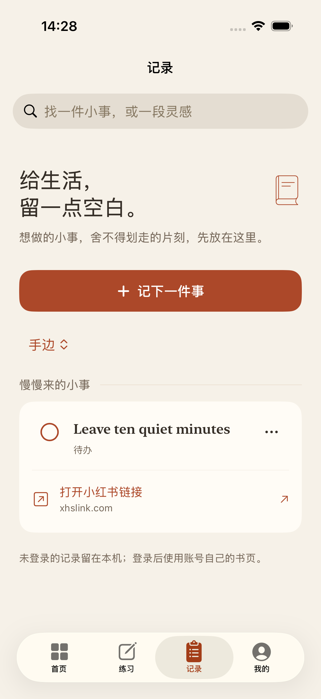
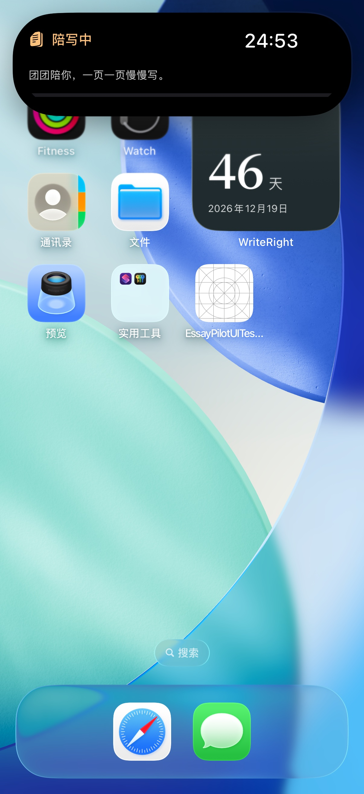
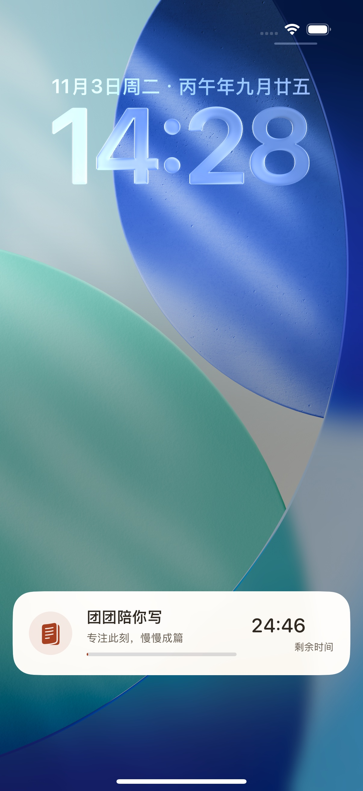

<div align="center">
  

  # WriteRight

  **让每一篇练习，都有清楚的下一步。**

  面向考研英语（二）的原生 iOS 写作与翻译练习应用，支持文字、手写照片、AI 批改、逐句建议和学习记录。

  [下载最新版本](https://github.com/YiYun-ll/WriteRight/releases/latest) · [功能特性](#功能特性) · [本地开发](#本地开发) · [参与贡献](CONTRIBUTING.md)

  
  
  
  
</div>

## 功能特性

- **作文与翻译练习**：小作文 10 分、大作文 15 分、英译汉 15 分，使用各自独立的评分标准。
- **文字与照片自由组合**：题目和作答可以分别输入文字或上传照片；手写原稿直接交给 AI 看图批改，无需中间转录。
- **可阅读的批改报告**：提供总览、逐句建议、修改稿和复盘，保留原稿、学生错误与图片页码引用。
- **完整学习链路**：草稿自动保存、历史搜索、成绩曲线、同题对比、表达收藏和备份导入导出。
- **安静的学习陪伴**：窗边书桌、陪伴小猫、专注计时、待办与灵感记录，不用打卡和排名制造压力。
- **系统级体验**：主屏幕小组件、锁屏实时活动与灵动岛；支持深色外观、Dynamic Type 和减少动态效果。
- **本地与云端协同**：SwiftData 本地存储，登录后通过 Supabase 同步账号自己的内容。

## 界面预览

### 真实大作文样例

以下界面使用 **2017 年考研英语（二）大作文题目与手写样例**。报告内容为界面演示数据；AI 模拟估分不代替正式阅卷。

<table>
  <tr>
    <td align="center"><br><b>题目编辑</b></td>
    <td align="center"><br><b>原稿提交</b></td>
    <td align="center"><br><b>批改总览</b></td>
    <td align="center"><br><b>逐句建议</b></td>
  </tr>
</table>

### 写作之外的学习体验

<table>
  <tr>
    <td align="center"><br><b>首页与陪伴</b></td>
    <td align="center"><br><b>翻译逐句解析</b></td>
    <td align="center"><br><b>待办与灵感</b></td>
  </tr>
</table>

### 小组件与实时活动

<table>
  <tr>
    <td align="center"><br><b>主屏幕小组件与灵动岛</b></td>
    <td align="center"><br><b>锁屏实时活动</b></td>
  </tr>
</table>

## 下载与安装

- 系统要求：**iOS 17 或更高版本**。
- 前往 [Releases](https://github.com/YiYun-ll/WriteRight/releases/latest) 下载最新 IPA 与 SHA-256 校验文件。
- Release 提供侧载包，需使用你自己的 Apple 签名环境完成签名后安装；签名有效期取决于所用账号和工具。
- 当前版本未上架 App Store。安装前请核对 Release 中的版本号与校验值。

## 技术栈

| 层级 | 技术 |
| --- | --- |
| 客户端 | SwiftUI、SwiftData、Combine、PhotosUI、VisionKit |
| 系统能力 | WidgetKit、ActivityKit、Live Activities、Keychain |
| 云端 | Supabase Auth、Postgres、Storage、Edge Functions |
| AI | DeepSeek，通过服务端调用；API Key 不进入客户端 |
| 工程化 | XcodeGen、Deno、Node.js、XCTest、GitHub Actions |

核心数据流：

```text
SwiftUI → AppModel / 业务模型 → SwiftData 本地存储
                         └────→ Supabase Auth / Sync / Storage
                                      └─→ Edge Functions → DeepSeek
```

更多实现边界见[架构说明](docs/architecture.md)。

## 本地开发

### 环境要求

- Xcode 与 iOS 模拟器 SDK
- XcodeGen
- Node.js 22.19 或更高版本
- Deno 2.9.6
- 本地后端开发所需的 Docker 环境

### 启动检查

```bash
npm ci
npm run env:check
npm run check
npm test
```

### iOS

```bash
npm run ios:generate
npm run ios:build
npm run ios:run
npm run test:ios
```

也可以直接用 Xcode 打开 `ios/EssayPilot.xcodeproj`。修改 `ios/project.yml` 后需重新运行 `npm run ios:generate`。

### 本地后端

```bash
cp .env.example supabase/.env.local
npm run backend:start
npm run test:db
npm run functions:serve
```

本地控制台位于 `http://127.0.0.1:54323`，测试邮件位于 `http://127.0.0.1:54324`。完整配置见[开发指南](docs/development.md)。

## 配置与密钥

- `ios/Config/Local.xcconfig.example`：客户端公开 Supabase 配置与本地签名示例。
- `.env.example`：服务端环境变量占位符；复制后只写入本地被忽略的配置文件。
- DeepSeek API Key、Supabase secret/service-role key、SMTP 凭据和签名材料只能保存在服务端密钥管理或本地私有配置中。
- 客户端只允许包含 Supabase URL 与 publishable/anon key。

请勿提交真实密钥、个人作文、认证令牌或签名文件。数据处理说明见[隐私与数据](docs/privacy.md)。

## 项目结构

```text
ios/                       SwiftUI 客户端、小组件与原生测试
supabase/functions/        Edge Functions、评分逻辑与共享契约
supabase/migrations/       版本化数据库迁移
supabase/tests/            数据库测试
schemas/                   共享 JSON Schema 入口
scripts/                   构建、检查与开发工具
tests/                     后端测试与合成样本
docs/                      开发、架构、隐私说明与产品截图
design/brand/              当前品牌成品资源
.github/workflows/         持续集成
```

## 参与贡献

欢迎提交 Issue 和 Pull Request。开始之前请阅读[贡献指南](CONTRIBUTING.md)，确保相关检查通过，并保持变更聚焦、可审查。

## 许可证

本项目基于 [MIT License](LICENSE) 开源。产品界面中使用的考试题目与手写样例仅用于功能展示，其权利仍归原权利人所有。
